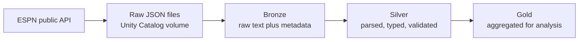

# NBA Lakehouse Pipeline

An incremental ETL pipeline on Databricks that ingests the 2026-27 NBA season from a public
API, validates it, and builds analysis-ready tables, using a Bronze / Silver / Gold
(medallion) architecture on Delta Lake. It runs daily as a scheduled Databricks job.

**What it demonstrates**
- Resilient ingestion: retries with exponential backoff, idempotent landing, incremental loads
- Spark transformations: JSON parsing with explicit schemas, nested `explode`, window functions
- Data quality gates that stop the pipeline before bad data is written
- Orchestration with Databricks Jobs: task dependencies, a daily schedule, retries, and alerts

## Architecture

The job `nba_pipeline` runs three notebook tasks in order, each reading from the layer below:

| Task | Notebook | Reads | Writes |
|---|---|---|---|
| `bronze_ingest` | `01_bronze_ingest` | ESPN API | `bronze_scoreboard`, `bronze_game_summary` |
| `silver_transform` | `02_silver_transform` | Bronze tables | `silver_games`, `silver_player_box_scores` |
| `gold_aggregates` | `03_gold_aggregates` | Silver tables | `gold_team_standings`, `gold_player_season_stats`, `gold_team_rolling_form` |

If a task fails, the tasks after it are skipped and the tables they would have written keep
their previous contents.

## Tables

| Table | One row per | Purpose |
|---|---|---|
| `bronze_scoreboard` | raw scoreboard file (one date) | Untouched API response plus `source_file` and `ingested_at` |
| `bronze_game_summary` | raw game file | Untouched box score response plus metadata |
| `silver_games` | final game | Date, teams, and scores, with proper types |
| `silver_player_box_scores` | player per game | Minutes and box score stats; players who did not play have null stats |
| `gold_team_standings` | team | Record, home and away splits, point differential |
| `gold_player_season_stats` | player | Totals, per-game averages, shooting percentages |
| `gold_team_rolling_form` | team per game | Record and scoring over the last 10 games as of each game |

## Design decisions

| Decision | Why | Trade-off |
|---|---|---|
| Bronze stores the raw response text, not parsed columns | If Silver logic has a bug, I can reprocess from Bronze without calling the API again | Bigger tables, and parsing is deferred to Silver |
| Raw files land in a volume first, then load into Bronze tables | Files are a replayable source of truth, and re-running never creates duplicates because file names come from the date or game ID | Bronze is rebuilt with `overwrite` from every file each run. That is simple and idempotent at this size, but at larger scale I would switch to Auto Loader or `COPY INTO` to load only new files |
| Scoreboards are overwritten; box scores are skipped if already landed | A date's results can still change, but a final game's box score will not | Fewer API calls, and a stat correction to an old final game would not be picked up |
| Each run re-fetches the last 3 days, not just yesterday | Catches late finishers and corrections, and retries any day that failed last time | A few redundant requests |
| `game_date` comes from the requested date, not the UTC tip-off time | Late US games cross midnight UTC and would be filed under the wrong day | The date column and the tip-off timestamp can legitimately differ |
| Silver parses JSON with an explicit schema | Reads only the fields I need and ignores the rest of a roughly 500 KB response | New fields from the source are ignored until I add them |
| Stats are mapped by position, guarded by a check on the label order | ESPN sends each player's stats as a positional list of strings | If ESPN reorders the stats, the run stops instead of putting numbers in the wrong columns |
| Quality gates raise before each write | A failed check stops the task, so bad data never reaches the table and downstream tasks are skipped | A single bad row blocks the run until I look at it |
| Gold tables are rebuilt from Silver on every run | They are small, so a full rebuild is simpler and safer than incremental updates | Would not scale to many seasons without rethinking |
| Retries only on the Bronze task | Bronze talks to the outside world, so its failures are often transient. Silver and Gold failures are deterministic, and retrying would just fail again | A genuinely broken Bronze run takes a few extra minutes to alert |
| Scheduled for 12:00 UTC | The previous night's last West Coast games are final by then | Runs after the US morning, not near real time |

## Problems I hit

**Both NBA-owned APIs blocked Databricks.** My first source, `stats.nba.com` (via the `nba_api` package), timed out from the workspace, and the NBA's CDN returned a 403 "Access Denied" from its bot protection. Both appear to block cloud IP ranges, so retries could not help. I switched to ESPN's public endpoints, which worked. Only the ingestion client changed, because the rest of the pipeline was built around raw files, which is the payoff of separating extraction from transformation.

**One player row broke a quality check.** My checks flagged one player, out of roughly 5,300 rows, who ESPN marked as having played but whose minutes were `--` and whose stats were all zero. ESPN's `didNotPlay` flag was unreliable here, as were other flags I looked at. I treated the exact `--` minutes pattern as did-not-play and left every check unchanged, so a different surprise would still be caught.

**A hard-coded date range would have broken the first incremental run.** A check that said "no games after the day I backfilled" would have failed the moment a new game landed. I replaced it with a range from the season opener to the current date, and filtered Silver to final games so postponed games cannot block the pipeline.

**A transient storage error during a job run.** One run failed with a volume error (`Errno 126`) while writing a file. A re-run succeeded, so I added a retry on the Bronze task, and the pipeline raises before loading Bronze if any fetch failed, so downstream tasks never run on incomplete data.

**Dividing by zero.** Databricks runs Spark in ANSI mode, where division by zero and bad casts raise errors instead of returning null. I used `try_cast` and `try_divide` so missing data becomes null, which is what "no attempts" and "did not play" should be.
