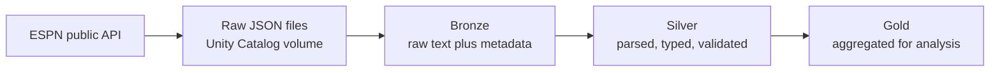

# NBA Lakehouse Pipeline

An incremental ETL pipeline on Databricks that ingests the 2026-27 NBA season from a public
API, validates it, and builds analysis-ready tables, using a Bronze / Silver / Gold
(medallion) architecture on Delta Lake. It runs daily as a scheduled Databricks job.

**What it demonstrates**
- Resilient ingestion: retries with exponential backoff, idempotent landing, incremental loads
- Spark transformations: JSON parsing with explicit schemas, nested `explode`, window functions
- Data quality gates that stop the pipeline before bad data is written
- Orchestration with Databricks Jobs: task dependencies, a daily schedule, retries, and alerts

## Architecture

The job `nba_pipeline` runs three notebook tasks in order, each reading from the layer below:

| Task | Notebook | Reads | Writes |
|---|---|---|---|
| `bronze_ingest` | `01_bronze_ingest` | ESPN API | `bronze_scoreboard`, `bronze_game_summary` |
| `silver_transform` | `02_silver_transform` | Bronze tables | `silver_games`, `silver_player_box_scores` |
| `gold_aggregates` | `03_gold_aggregates` | Silver tables | `gold_team_standings`, `gold_player_season_stats`, `gold_team_rolling_form` |

If a task fails, the tasks after it are skipped and the tables they would have written keep
their previous contents.

## Tables

| Table | One row per | Purpose |
|---|---|---|
| `bronze_scoreboard` | raw scoreboard file (one date) | Untouched API response plus `source_file` and `ingested_at` |
| `bronze_game_summary` | raw game file | Untouched box score response plus metadata |
| `silver_games` | final game | Date, teams, and scores, with proper types |
| `silver_player_box_scores` | player per game | Minutes and box score stats; players who did not play have null stats |
| `gold_team_standings` | team | Record, home and away splits, point differential |
| `gold_player_season_stats` | player | Totals, per-game averages, shooting percentages |
| `gold_team_rolling_form` | team per game | Record and scoring over the last 10 games as of each game |
